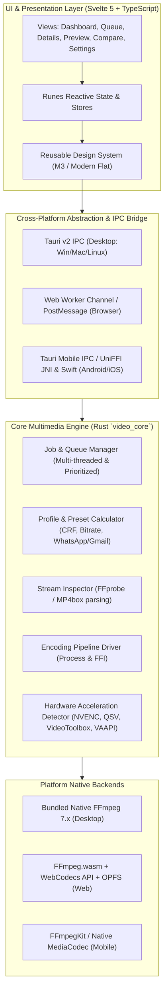

# 04. System Architecture & Cross-Platform Technology Specification

## 1. Executive Architectural Recommendation

To deliver an independent, high-performance, private, and offline video compression application spanning **Windows, macOS, Linux, Web, Android, and iOS**, we propose a **modular multi-tier architecture** with a **Rust multimedia core** and a **Svelte 5 / TypeScript reactive UI layer**.



---

## 2. Technology Stack Evaluation & Trade-Off Matrix

### A. Multimedia Engine: Rust vs. Native C++ vs. Process Invocation

| Criterion | Direct C-FFI / Bindings (`ffmpeg-sys-next`) | Rust Orchestrator + Process Invocation (`ffmpeg` CLI) | Hybrid Recommendation |
|---|---|---|---|
| **Safety & Stability** | Memory crashes in native C FFmpeg libraries can crash host process. | Subprocess crashes are completely isolated and caught safely. | **Hybrid**: Process execution on Desktop; C-FFI/JNI/WASM where fork/exec is prohibited (iOS, Web). |
| **Performance Overhead** | Zero overhead (direct struct passing in RAM). | Minor process invocation overhead (~20ms), negligible for video transcoding. | Overhead is unmeasurable during multi-second/minute encoding jobs. |
| **Licensing Isolation** | Static C-FFI linking risks GPL contagion unless carefully managed. | Process execution cleanly respects **LGPL / GPL boundaries** through strict command isolation. | Complies with proprietary/independent commercial distribution policies. |
| **Hardware Acceleration** | Requires custom C boilerplate for each platform hardware context. | Standard FFmpeg CLI includes built-in `-hwaccel auto`, `-c:v h264_nvenc`, etc. | Native CLI automatically handles hardware handshakes cleanly. |

**Decision**: 
- **Desktop (Win/Mac/Linux)**: Rust `video_core` driving managed, sandboxed FFmpeg binaries via child process channels with real-time stderr progress parsing.
- **Web (Browser)**: Svelte + WebAssembly (`@ffmpeg/ffmpeg`) leveraging WebCodecs for hardware decode/encode and Origin Private File System (OPFS) for gigabyte file buffering.
- **Mobile (Android/iOS)**: Rust core compiled via `cargo-ndk` and UniFFI for iOS, interfacing with platform MediaCodec/VideoToolbox or LGPL FFmpegKit.

---

### B. Frontend Framework: Svelte 5 vs. React vs. Flutter

| Framework | Bundle Size | Memory Footprint | Reactivity Model | Cross-Platform Portability |
|---|---|---|---|---|
| **Svelte 5 (Runes)** | **Smallest (~40 KB)** | **Lowest (No Virtual DOM)** | **Fine-grained signal-like reactivity** | **Universal (DOM, Tauri Webview, Mobile Webview, Web)** |
| React | Medium (~140 KB) | High (Virtual DOM reconciler) | Hook-based re-renders | Universal |
| Flutter | Large (~20–40 MB engine) | Medium-High (Skia/Impeller) | Reactive widget tree | Non-web first; separates web and desktop UX |

**Decision**: **Svelte 5 with TypeScript** provides unmatched performance, instantaneous boot times, minimal RAM footprint, and 100% component reusability across Desktop, Web, and Mobile.

---

### C. Desktop Platform: Tauri v2 vs. Electron

| Dimension | Tauri v2 | Electron | Verdict |
|---|---|---|---|
| **Binary Size** | ~8 MB to 15 MB | 120 MB to 200 MB | **Tauri wins by 90% reduction** |
| **Idle Memory Consumption** | ~30 MB to 45 MB | 180 MB to 350 MB | **Tauri wins by 80% reduction** |
| **Security & Sandboxing** | Rust capability-based IPC security | Node.js system access | **Tauri is vastly superior** |
| **Build & Toolchain** | Rust + OS Webview (Edge WebView2, WebKitGTK, WKWebView) | Bundled Chromium + Node | **Tauri** |

**Decision**: **Tauri v2** is the premier choice for Desktop.

---

## 3. Modular Architecture Breakdown

### Module 1: Multimedia Core (`video_core`)
- Written in Rust.
- Responsible for:
  - FFmpeg execution and process supervision.
  - Asynchronous progress parsing (reading `frame=`, `fps=`, `out_time_ms=`, `speed=`, `bitrate=`).
  - Graceful cancellation (`SIGINT` / `CTRL_BREAK_EVENT` with 3-second deadline before `SIGKILL`).
  - Temporary scratch directory lifecycle and atomic rename on completion.

### Module 2: Profile & Preset Calculator
- Implements the mathematical formulas extracted during reverse engineering:
  1. **CRF Calculator**: Preserves native resolution with perceptual constant quality.
  2. **Target File Size Calculator**: Calculates target bitrate given file duration, audio overhead, and safety margin (5% margin to prevent exceeding WhatsApp 16 MB or Gmail 25 MB caps).
  3. **Macroblock Aligner**: Guarantees output dimensions are valid multiples of 2 (`w = (w >> 1) << 1`).

### Module 3: Stream Inspector (`probe`)
- Executes fast metadata probe on import:
  - Container format, duration, bitrate, file size.
  - Video stream: Codec, resolution, display aspect ratio, pixel format, frame rate, rotation metadata.
  - Audio stream: Codec, channel count, sample rate, bitrate.
  - Checks whether video is already optimally compressed.

### Module 4: Concurrent Job & Queue Manager
- Overcomes Proton’s single-threaded serial bottleneck:
  - Configurable worker concurrency (default: 1 for 4K/heavy encodes, 2–4 for 1080p/720p clips on multi-core PCs).
  - Priority re-ordering (drag-and-drop queue).
  - Pause, resume, and retry failed jobs without restarting the batch.

### Module 5: Preview & Fast-Scrub Engine
- Slices arbitrary timestamp offsets with ultrafast encoding.
- Supplies temporary 5s–30s segments directly to Svelte video players for immediate quality verification.

### Module 6: Comparison Subsystem
- Synchronized dual playback with scrub lock.
- **Split-Screen Slider**: Custom canvas/CSS shader overlay allowing users to drag a split bar across the video frame to compare compression artifacts side by side on identical frames.

---

## 4. Frontend-Backend Communication Contracts (IPC)

All communication between the Svelte frontend and the Rust backend uses typed, schema-validated asynchronous IPC commands and events.

### A. IPC Commands (Frontend -> Backend)

```typescript
// Inspect Video File
type ProbeVideoRequest = { filePath: string };
type ProbeVideoResponse = {
  durationSeconds: number;
  width: number;
  height: number;
  videoCodec: string;
  audioCodec: string | null;
  bitrateKbps: number;
  fileSizeBytes: number;
  rotation: number;
  isAlreadyOptimal: boolean;
};

// Start Compression Task
type StartCompressionRequest = {
  jobId: string;
  inputPath: string;
  outputPath: string;
  preset: "optimal" | "medium" | "small" | "whatsapp" | "gmail" | "custom_size" | "custom_resolution";
  customSettings?: {
    targetWidth?: number;
    targetHeight?: number;
    targetSizeBytes?: number;
    removeAudio?: boolean;
    volumeMultiplier?: number; // 0.0 to 3.0
    copyMetadata?: boolean;
    allowSizeIncrease?: boolean;
    hardwareAcceleration?: boolean;
  };
};

// Cancel Compression
type CancelJobRequest = { jobId: string };
```

### B. IPC Events (Backend -> Frontend Streaming)

```typescript
// Real-time Progress Event
type CompressionProgressEvent = {
  jobId: string;
  percent: number; // 0.0 to 100.0
  currentFps: number;
  timeRemainingSeconds: number;
  currentBitrateKbps: number;
  processedSeconds: number;
};

// Completion Event
type CompressionCompleteEvent = {
  jobId: string;
  success: boolean;
  originalSizeBytes: number;
  compressedSizeBytes: number;
  reductionPercentage: number;
  outputPath: string;
  alreadyOptimalTriggered: boolean;
  errorMessage?: string;
};
```

---

## 5. Web Browser Architecture (WebAssembly & WebCodecs)

To guarantee 100% offline functionality in the browser without server uploads:
1. **Origin Private File System (OPFS)**: Large video files (1 GB+) are streamed directly into browser-managed virtual disk blocks rather than allocated in JavaScript heap memory, avoiding the 4 GB WASM memory ceiling.
2. **WebCodecs API**: Modern Chromium/Safari browsers support hardware decoding/encoding directly via `VideoEncoder` and `VideoDecoder`.
3. **FFmpeg WASM Fallback**: For containers or codecs unsupported by native WebCodecs, `@ffmpeg/ffmpeg` (WASM with multi-threading web workers) performs the transcode entirely in a background web worker thread.
