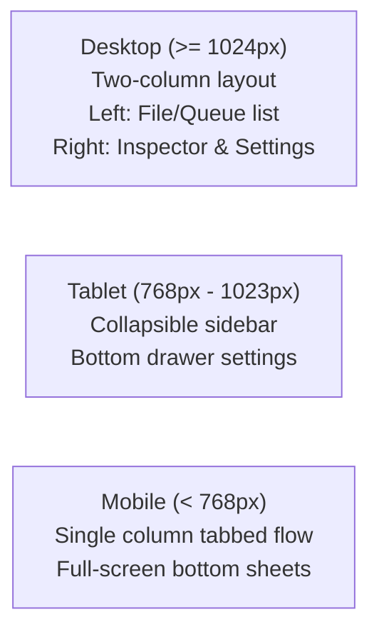

# 05. User Experience & User Interface Design Specification

## 1. Design Philosophy & Visual Identity

The new application interface is an **original, modern, clean, and professional design** engineered for cross-platform responsiveness (Desktop, Tablet, Mobile, and Web). 

### Key Design Pillars:
- **Zero Clutter, Zero Distraction**: 100% ad-free, dark/light theme adaptive, high contrast, clean typography.
- **Immediate Utility**: Drag-and-drop first on desktop; native gallery picker on mobile and web.
- **Real-Time Transparency**: Instant bitrate and size estimation before pressing "Compress"; granular FPS and time-remaining progress during encode.
- **Interactive Verification**: Direct interactive split-screen scrubber allowing instant visual comparison before and after compression.

---

## 2. Complete Screen Inventory & Responsive Layouts

### A. Screen 1: Dashboard & Drag-and-Drop Video Import
- **Purpose**: Welcoming landing state and immediate batch/single video import.
- **Desktop UI**:
  - Central large dropzone with dashed accent border: *"Drag and drop video files or folders here"*.
  - Secondary buttons: *"Browse Files"* (native file dialog) and *"Import Folder"*.
  - Recent compressions strip at bottom with cumulative space-saved stats counter (e.g. *"Total space saved: 14.8 GB"*).
- **Mobile / Web UI**:
  - High-visibility primary action button *"Select Videos"*.
  - Grid preview of recent device albums and media items.

---

### B. Screen 2: Video Information & Stream Inspector
- **Purpose**: Displays detailed technical parameters of imported media.
- **Components**:
  - Interactive video thumbnail card with playable hover/touch scrub preview.
  - Video Metadata Grid:
    - **Resolution**: Width × Height with aspect ratio badge (e.g., `1920 × 1080 (16:9)`).
    - **Duration**: `HH:MM:SS` format.
    - **Original Size**: Exact bytes formatted in MB / GB.
    - **Video Codec & Bitrate**: (e.g. `H.264 / AVC @ 18.5 Mbps`).
    - **Audio Codec & Channels**: (e.g. `AAC Stereo @ 192 kbps`).
    - **Frame Rate**: (e.g. `59.94 fps`).
    - **Rotation Tag**: Display orientation (0°, 90°, 180°, 270°).

---

### C. Screen 3: Compression Settings & Preset Selector
- **Purpose**: The central configuration panel for encoding profiles.
- **Preset Cards (Radio Selection)**:
  1. **Optimal Quality (Recommended)**:
     - Badge: *"Best for Archiving & Sharing"*.
     - Description: Keeps original resolution, applies perceptual CRF rate control.
     - Estimated Size: Dynamic reduction indicator (e.g. *"~65% smaller (approx. 120 MB)"*).
  2. **Medium Quality**:
     - Badge: *"Balanced"*.
     - Downscales to 720p or applies proportional bitrate target.
  3. **Small Size**:
     - Badge: *"Maximum Space Savings"*.
     - Downscales to 480p with constrained bitrate.
  4. **WhatsApp Optimized**:
     - Badge: *"Strict 16 MB Cap"*.
     - Automatically adjusts bitrate to guarantee output never exceeds 16 MB.
  5. **Gmail Optimized**:
     - Badge: *"Strict 25 MB Cap"*.
     - Bitrate calculated for email attachment ceilings.
  6. **Custom Target Size**:
     - Interactive slider + direct numeric input in MB.
     - Live bitrate calculation feedback.
  7. **Custom Resolution**:
     - Width and Height inputs with *"Lock Aspect Ratio"* switch.
     - Percentage scale slider (25%, 50%, 75%, 100%).
     - Real-time multiples-of-2 validation indicator.

---

### D. Screen 4: Advanced Encoding & Audio Options Drawer
- **Purpose**: Granular control for power users without cluttering the primary view.
- **Controls**:
  - **Codec Selector**: H.264 (Maximum Compatibility), H.265 / HEVC (High Efficiency), AV1 (Next-Gen Open), VP9.
  - **Hardware Acceleration**: Auto-detect toggle (NVENC, QuickSync, VideoToolbox, VAAPI, MediaCodec).
  - **Audio Track Handling**:
    - Toggle: *"Keep Audio"* / *"Remove Audio (Mute)"*.
    - Volume Slider: `0%` to `300%` (with `Reset to 100%` button).
    - Audio Codec & Bitrate: AAC, Opus, MP3 (64k, 96k, 128k, 192k).
  - **Container Format**: MP4, MKV, WebM.
  - **Metadata Preservation**: Checkbox *"Copy Original Metadata & EXIF"*.
  - **Output File Naming**: Pattern template (e.g., `{name}_compressed.{ext}`).

---

### E. Screen 5: Fast Preview & Timeline Slicer
- **Purpose**: Instant verification before initiating a full compression run.
- **UI Elements**:
  - Mini video player with interactive timeline scrub bar.
  - Segment Duration Chips: `5s`, `10s`, `15s`, `30s`, `Full`.
  - Timestamp offset handle: Draggable window indicating which section will be sampled.
  - *"Generate Preview"* button rendering the slice in 2–4 seconds via `ultrafast` preset.
  - Side-by-side bitrate preview panel.

---

### F. Screen 6: Batch Queue & Real-Time Processing
- **Purpose**: Live visualization of active compression jobs.
- **Queue Components**:
  - List of pending, active, and completed items.
  - For active item:
    - Large animated progress bar with smooth percentage indicator.
    - Statistics: Current FPS, Encoding Speed (e.g. `2.4x realtime`), Elapsed Time, Time Remaining (`ETA`), Output Size accumulator.
    - Action buttons: *"Pause"*, *"Cancel"*.
  - Concurrency control: Concurrency slider (1 to 4 parallel workers).

---

### G. Screen 7: Interactive Comparison View (Dual Player & Split-Slider)
- **Purpose**: Side-by-side and overlay comparison of uncompressed vs compressed media.
- **Dual Player Mode**:
  - Synchronized play/pause and seekbar controlling both streams simultaneously.
  - Left pane: Original (with original file size).
  - Right pane: Compressed (with final file size and % reduction).
- **Split-Slider Mode (Advanced UX Improvement)**:
  - Single viewport with a vertical draggable divider.
  - Left of divider displays original frame; right of divider displays compressed frame.
  - Allows pixel-perfect inspection of edge sharpness, banding, and noise reduction.

---

### H. Screen 8: Completed Jobs & File Actions
- **Purpose**: Post-processing summary and immediate file operations.
- **Actions per Video Card**:
  - **Open Output File** / **Reveal in File Explorer**.
  - **Share** (Desktop OS share picker / Mobile system share sheet).
  - **Compare Quality** (Opens Screen 7).
  - **Delete Original** (With safety confirmation modal showing exact disk space recovered).
  - **"Already Optimal" Badge**: Displayed if original was retained because compression would have inflated file size.

---

### I. Screen 9: Application Preferences
- **Settings**:
  - Default Output Directory (customizable file picker).
  - Default Output Naming Convention.
  - "Allow Size Increase" Safety Guard toggle (default OFF).
  - Preferred Video Codec default.
  - Theme: System / Dark / Light.
  - Multi-threaded Worker Limit.

---

## 3. Responsive Breakpoint Strategy

1. **Desktop (>= 1024px)**:
   - Split-pane layout: Left panel shows imported batch list and queue; right panel shows selected video details, live preview, and preset adjustments.
   - Hotkeys: `Space` (Play/Pause), `Ctrl+O` (Open File), `Ctrl+Enter` (Start Batch), `Esc` (Cancel).

2. **Mobile (< 768px)**:
   - Bottom navigation bar: `Library`, `Queue`, `History`, `Settings`.
   - Settings open in smooth Material 3 bottom sheets.
   - Large touch targets (minimum 48×48 dp).
