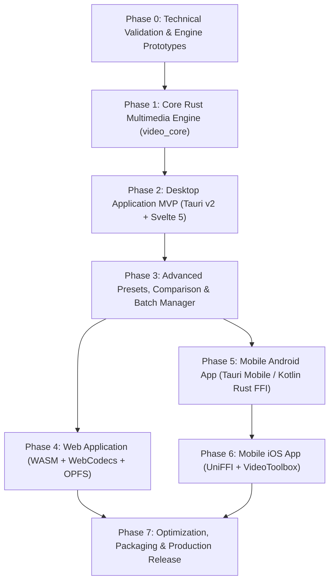

# 06. Comprehensive Multi-Phase Implementation Roadmap

## 1. Executive Implementation Strategy

The development plan follows an incremental, test-driven engineering approach. Each phase builds upon verified previous deliverables, prioritizing technical de-risking, cross-platform code reuse, and automated validation.

---

## Phase 0: Technical Validation & Architecture Prototypes

- **Objectives**: Validate Rust child-process communication with FFmpeg, benchmark progress parsing latency, prototype WebCodecs/OPFS in browser, test hardware acceleration hooks.
- **Components & Files**:
  - `crates/video_core/src/probe.rs` (FFprobe JSON parser prototype).
  - `crates/video_core/src/process.rs` (Async stderr line-reader with regex).
  - `web_prototype/opfs_test.html` (OPFS stream write benchmark).
- **Dependencies**: `tokio`, `serde`, `serde_json`, `regex`.
- **Acceptance Criteria**:
  - Rust child process reliably starts FFmpeg, receives frame-by-frame progress within 50ms latency, and terminates cleanly on cancellation token without orphan processes.
  - Web prototype writes 500 MB chunked stream to OPFS without exceeding 50 MB JavaScript heap.
- **Risks**: Windows `CTRL_BREAK_EVENT` process group handling; mitigated via `tokio::process::Command::kill_on_drop(true)`.

---

## Phase 1: Core Video Inspection & Compression Engine (`video_core`)

- **Objectives**: Build the production-ready Rust multimedia engine shared across desktop and mobile.
- **Features**:
  - Video stream inspection (resolution, duration, fps, bitrate, audio profile).
  - Preset calculation algorithms (CRF 27, Medium 720p, Small 480p, WhatsApp 16 MB, Gmail 25 MB).
  - Bitrate calculation: $\text{Bitrate} = (\text{TargetBytes} \times 8) / \text{Duration} - \text{AudioBitrate}$.
  - Dimension alignment to even multiples of 2 (`w & !1`, `h & !1`).
  - Audio filters (Volume gain 0.0 to 3.0, Audio mute `-an`).
  - Metadata pass-through (`-map_metadata 0`).
  - "Already Optimal" guard logic (aborts output replacement if output size >= input size).
- **Files to Create**:
  - `crates/video_core/src/lib.rs`
  - `crates/video_core/src/probe.rs`
  - `crates/video_core/src/presets.rs`
  - `crates/video_core/src/command_builder.rs`
  - `crates/video_core/src/executor.rs`
  - `crates/video_core/src/queue.rs`
- **Dependencies**: `tokio = { version = "1", features = ["full"] }`, `thiserror = "1.0"`, `tracing = "0.1"`.
- **Automated Tests**:
  - Unit tests for bitrate math against boundary conditions (zero duration, extreme file size targets).
  - Integration tests running FFmpeg CLI against synthetic video files verifying output validity.
- **Acceptance Criteria**: 100% test pass on all 8 test scenarios defined in `03-TECHNICAL-ANALYSIS.md`.

---

## Phase 2: Desktop Application MVP (Tauri v2 + Svelte 5)

- **Objectives**: Deliver a functional desktop application for Windows, macOS, and Linux.
- **Features**:
  - Native file drag-and-drop.
  - Video inspector card showing source parameters.
  - Preset selection cards (Optimal, Medium, Small, WhatsApp, Gmail).
  - Single and multi-file processing with real-time percentage progress bar.
  - Cancellation support.
  - Results card with output size, reduction percentage, and "Reveal in File Explorer".
- **Files to Create**:
  - `src-tauri/src/main.rs` & `src-tauri/src/commands.rs` (Tauri IPC endpoints).
  - `src/lib/components/DropZone.svelte`
  - `src/lib/components/VideoInspector.svelte`
  - `src/lib/components/PresetSelector.svelte`
  - `src/lib/components/ProgressBar.svelte`
  - `src/lib/components/ResultsCard.svelte`
  - `src/routes/+page.svelte`
- **Dependencies**: `@tauri-apps/api@2`, `svelte@5`, `tailwindcss`, `lucide-svelte`.
- **Acceptance Criteria**: Desktop binary compiles under 15 MB; successfully compresses imported videos locally without internet connectivity.

---

## Phase 3: Advanced Presets, Comparison & Batch Queue

- **Objectives**: Implement feature parity with Proton’s power tools plus our UI/UX improvements.
- **Features**:
  - **Custom Resolution Dialog**: Width/height inputs, aspect ratio locking, slider.
  - **Custom File Size Dialog**: Target MB input, stepper buttons, live bitrate indicator.
  - **Volume Boost & Mute**: Slider from 0% to 300% with Reset.
  - **Fast Segment Preview**: Duration chips (5s, 10s, 15s, 30s) rendering in <5 seconds.
  - **Interactive Comparison**: Dual synced player and **interactive split-slider comparison**.
  - **Multi-Worker Queue**: Configurable concurrent jobs (1 to 4 parallel workers).
  - **Delete Original Action**: Safe deletion with explicit confirmation modal.
- **Files to Create**:
  - `src/lib/components/CustomResolutionModal.svelte`
  - `src/lib/components/CustomFileSizeModal.svelte`
  - `src/lib/components/PreviewSegmentModal.svelte`
  - `src/lib/components/CompareSplitSlider.svelte`
  - `src/lib/components/QueueManager.svelte`
- **Acceptance Criteria**: Split-slider smoothly tracks mouse/touch movement; multi-worker queue completes a batch of 5 videos faster than serial execution.

---

## Phase 4: Web Application (WASM + WebCodecs + OPFS)

- **Objectives**: Enable browser-based, zero-install, 100% offline local compression.
- **Features**:
  - OPFS virtual file buffer handling video files up to 2 GB.
  - WebCodecs hardware accelerated transcoding for supported browsers.
  - FFmpeg.wasm worker fallback for complex codecs/filters.
  - Identical Svelte 5 UI components reused from Desktop.
- **Files to Create**:
  - `src/lib/engine/web/opfs.ts`
  - `src/lib/engine/web/webcodecs_driver.ts`
  - `src/lib/engine/web/ffmpeg_wasm_driver.ts`
- **Dependencies**: `@ffmpeg/ffmpeg`, `@ffmpeg/util`.
- **Acceptance Criteria**: Works completely offline (PWA installed); zero server upload verified in network inspector.

---

## Phase 5: Android Application (Tauri Mobile / Kotlin Rust FFI)

- **Objectives**: Deliver modern, native Android video compressor.
- **Features**:
  - Granular photo/video picker (`READ_MEDIA_VIDEO`, `READ_MEDIA_VISUAL_USER_SELECTED`).
  - Android Foreground Service with persistent notification channel and live progress.
  - Battery optimization guidance screen ("Don't kill my app").
  - System share sheet integration (`FileProvider`).
  - Scoped storage output writing (`MediaStore.Video`).
- **Files to Create**:
  - `src-tauri/gen/android/` or `android/app/src/main/java/.../CompressionForegroundService.kt`
  - `android/app/src/main/java/.../StorageHelper.kt`
- **Acceptance Criteria**: Compression continues smoothly while user switches apps; notification displays updating percentage.

---

## Phase 6: iOS Application (UniFFI + VideoToolbox)

- **Objectives**: Deliver iOS app matching iOS Human Interface Guidelines.
- **Features**:
  - Photos framework import (`PHPickerViewController`).
  - Hardware accelerated transcode via AVFoundation / VideoToolbox.
  - Background task scheduling (`BGProcessingTaskRequest`).
  - Direct save to Camera Roll.
- **Files to Create**:
  - `ios/App/VideoCompressor/PhotosBridge.swift`
  - `ios/App/VideoCompressor/VideoToolboxTranscoder.swift`
- **Acceptance Criteria**: 1080p video compresses on iPhone hardware in near-realtime with minimal battery impact.

---

## Phase 7: Optimization, Packaging & Release

- **Objectives**: Final optimization, licensing audits, automated CI/CD pipelines, and multi-platform distribution.
- **Tasks**:
  - Binary strip and LTO (Link-Time Optimization) in `Cargo.toml`.
  - Windows MSI/EXE installer with code signing.
  - macOS DMG / PKG with Universal (Intel/Apple Silicon) binary & notarization.
  - Linux AppImage & Flatpak.
  - Android APK / AAB.
  - Third-party open-source license disclosure generation (`cargo-about`).
- **Acceptance Criteria**: Zero crash reports on release builds; automated test suite passes on GitHub Actions runners across Windows, macOS, and Linux.
